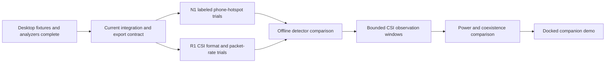
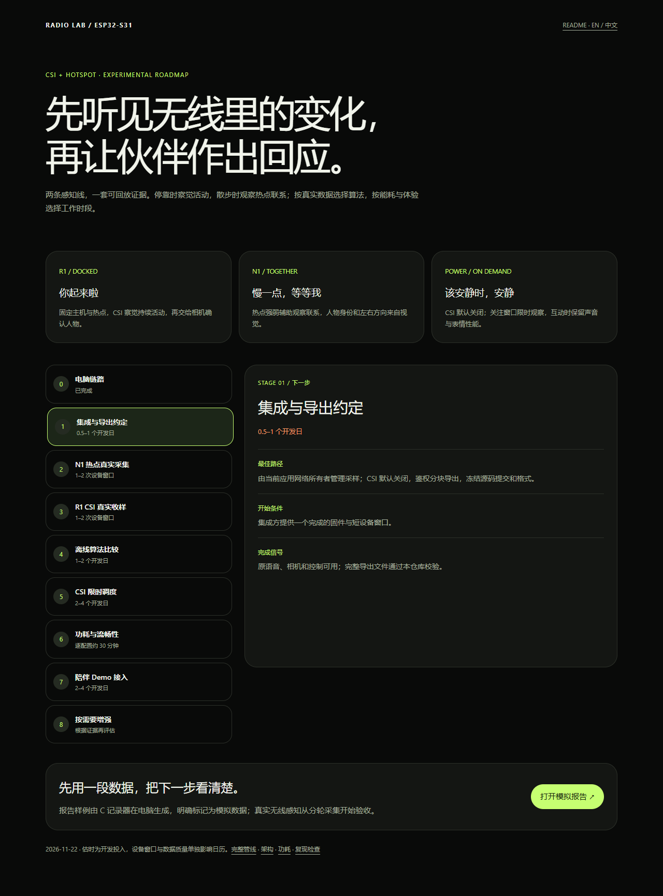
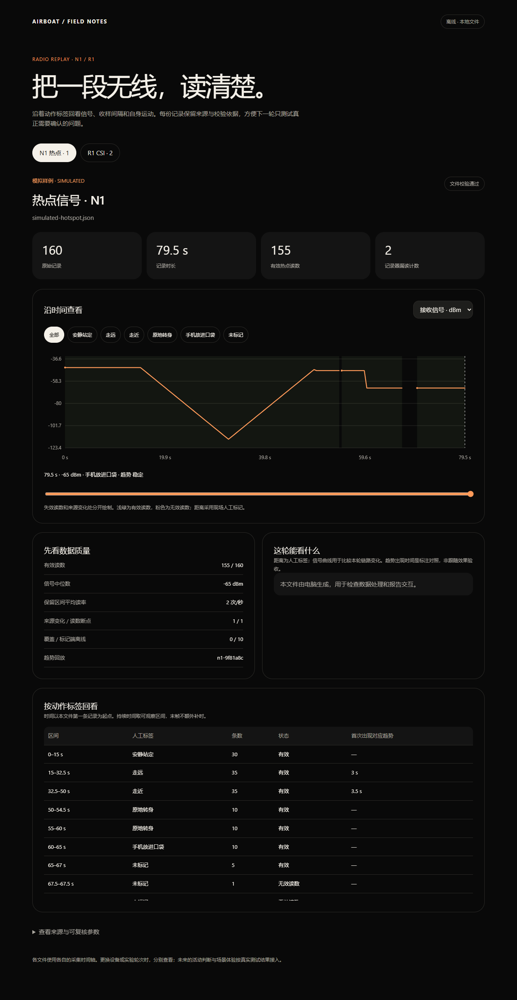

# ESP-Based CSI Perception & Wi-Fi Detection

[English](#english) | [简体中文](#简体中文)

## English

An experimental ESP32-S31 project for fixed-dock Wi-Fi CSI activity sensing and phone-hotspot RSSI trend research. It includes bounded capture components, offline validation and replay tools, simulated examples, and a staged plan for real-data and power evaluation.

### Start here

- [Development roadmap](docs/DEVELOPMENT_PLAN.md): stages, estimated effort, dependencies, and exit criteria.
- [简体中文完整路线](docs/DEVELOPMENT_PLAN.zh-CN.md): stage-by-stage work and acceptance signals.
- [Architecture](docs/ARCHITECTURE.md): data flow, component boundaries, and integration contract.
- [Power plan](docs/POWER_PLAN.md): bounded CSI windows and whole-device measurement.
- [Reproduce desktop checks](docs/TESTING.md).
- [Dated validation record](docs/VALIDATION.md).
- [Open the simulated report](examples/report/report.html).
- [Interactive stage map](docs/index.html): browse each phase, input requirement, and completion signal.

### Current package

| Area | Included | Evidence boundary |
| --- | --- | --- |
| N1 hotspot | Bounded recorder and relative RSSI trend | C tests; real phone movement and RF performance remain to be measured |
| R1 CSI | S31 LLTF8 configuration adapter, bounded callback queue, JSONL encoder and quality analyzer | Host tests and fixed-SDK translation-unit checks in the source package; real payload layout and packet rate remain to be measured |
| Offline review | HTML report for N1 JSON and R1 CSI JSONL | Browser-tested with simulated data |
| Power-aware sensing | Design for CSI-off-by-default and bounded observation windows | Design only; no power-saving percentage is claimed |

All included capture files are synthetic fixtures and explicitly marked `simulated=true`. They test parsing, replay and presentation; they are not radio measurements. This repository delivers reusable components and research tools; application integration is stage 1 of the roadmap.

### Development sequence

See the [full roadmap](docs/DEVELOPMENT_PLAN.md) for gates and estimates. Estimates are engineering effort, not calendar commitments; single-device access and real-data quality set the pace.

### License

Repository documentation and project glue use the repository [MIT License](LICENSE). Imported radio components and their tests retain their Apache-2.0 SPDX notices; see [LICENSES/Apache-2.0.txt](LICENSES/Apache-2.0.txt) and [source manifest](docs/source-manifest.json).

---

## 简体中文

这是一个面向 ESP32-S31 的无线感知实验项目，研究两条能力：停靠时通过 Wi-Fi CSI 察觉环境活动，以及外出时用手机热点 RSSI 趋势辅助判断联系变远或恢复。仓库包含有界采集组件、离线校验与回放、模拟样例，以及逐阶段的真实数据和功耗验证路线。

### 从这里开始

- [开发管线](docs/DEVELOPMENT_PLAN.zh-CN.md)：每阶段预计投入、前置条件、技术路径和完成标准。
- [可视化路线](docs/index.html)：逐步查看目标、前置条件和完成信号。
- [软件架构](docs/ARCHITECTURE.md)：数据流、模块边界与集成约定。
- [功耗方案](docs/POWER_PLAN.md)：CSI 限时观察和整机功耗测量。
- [电脑端复现检查](docs/TESTING.md)。
- [本轮验证记录](docs/VALIDATION.md)。
- [打开模拟数据报告](examples/report/report.html)。

*The report screenshot uses simulated data.*

### 当前包含什么

| 模块 | 仓库内容 | 证据边界 |
| --- | --- | --- |
| N1 热点 | 有界记录器和相对 RSSI 趋势 | C 测试已覆盖；真实手机移动与无线效果待测 |
| R1 CSI | S31 LLTF8 配置适配、有界回调队列、JSONL 编码和质量分析 | 源码包包含电脑检查与固定 SDK 编译单元检查；真实载荷格式和包率待测 |
| 离线报告 | 读取 N1 JSON 与 R1 CSI JSONL 的交互报告 | 已用模拟数据通过浏览器检查 |
| 功耗感知 | CSI 默认关闭与限时观察设计 | 目前是设计，尚无省电百分比结论 |

仓库内的采集文件均为模拟样例，并明确标注 `simulated=true`。它们用于检查解析、趋势回放和报告交互，不代表真实无线结果。本项目提供可移植组件与研究资料，完整应用接入按第 1 阶段推进。

### 开发顺序

电脑端模拟与分析工具已完成。下一步先确认当前应用版本的集成和导出契约，再分别采集 N1 热点与 R1 CSI 的真实数据。数据质量通过后，比较活动检测方法；之后才实现限时 CSI 观察、测量整机功耗与共存，最后接入停靠陪伴体验。

完整阶段、时间估计和验收门槛见[开发管线](docs/DEVELOPMENT_PLAN.zh-CN.md)。时间是工程投入估算，不是日历承诺；进度取决于单台设备的测试窗口和真实数据质量。

### 许可证

仓库文档和项目辅助代码采用 [MIT License](LICENSE)。迁入的无线组件与测试保留 Apache-2.0 SPDX 标记，见 [LICENSES/Apache-2.0.txt](LICENSES/Apache-2.0.txt) 与[源码清单](docs/source-manifest.json)。
