# Architecture

## Data path

```mermaid
flowchart LR
  AP[Phone hotspot / fixed AP] --> RX[Existing Wi-Fi owner]
  RX --> RSSI[Network snapshot: RSSI, BSSID, channel, read age]
  RSSI --> N1[N1 bounded recorder]
  AP -->|received packets| CSI[S31 CSI callback]
  CSI -->|copy bounded metadata and bytes| Q[32-frame queue]
  Q --> EXPORT[Low-priority consumer / authenticated export]
  N1 --> FILE1[N1 JSON]
  EXPORT --> FILE2[R1 CSI JSONL]
  FILE1 --> REVIEW[Offline validators and replay]
  FILE2 --> REVIEW
  REVIEW --> DECISION[Data-quality and detector decision]
  DECISION -. later integration .-> SCENE[Activity event with freshness]
  SCENE --> VISION[Camera confirms identity and direction]
  VISION --> COMPANION[Voice, eyes and bounded motion]
```

## Ownership boundaries

| Owner | Owns | Does not do |
| --- | --- | --- |
| Existing network service | Wi-Fi mode, connect/reconnect, associated AP snapshot, CSI callback/config/enable and sampling lifecycle | No second Wi-Fi stack, no experiment-owned scanning or AP configuration |
| N1 recorder | Fixed-size history, labels, validity, run identity and relative trend | No Wi-Fi calls, allocation, distance conversion, direction, or motor action |
| R1 callback adapter | Copy validated source metadata and bounded bytes into the queue | No parsing, logging, HTTP, allocation, waiting, detector or scene work |
| Export owner | Finalize an immutable capture and serve authenticated bounded chunks | No large JSON response in a control/voice callback |
| Offline tools | Validate counters, labels, source hashes, time gaps and historical N1 replay | No network connection, no hidden inference, no firmware/device operations |
| Future scene owner | Apply freshness, visual confirmation, cooldown, user cancellation and priority | No direct radio or motor control |

## Contracts

- **N1 observation time:** timestamp records when the device reads the AP information. Driver measurement age is unknown. RSSI is a relative trend; it does not provide meters, direction or identity.
- **CSI provenance:** one session manifest, ordered raw-frame records and final counters. Original bytes and invalid-prefix flags remain visible until the exact S31 layout is confirmed.
- **Motion eligibility:** an experimental frame is eligible only with fresh, known body/head evidence. Self-motion remains recorded but is excluded from stationary-room activity evidence.
- **Run boundaries:** network generation, BSSID, channel, layout or motion epoch changes reset detector background. Disconnected, stale or CSI-off periods produce `unknown`, not “quiet”.
- **Power lifecycle:** recorder stop alone is not driver stop. The network owner closes admission, disables optional traffic and `esp_wifi_set_csi(false)`, settles callbacks and finalizes the run before release.
- **Time axes:** each capture uses its own monotonic time. Independent device clocks are never aligned by assumption.

## Current repository boundary

`components/app_radio_probe`, `components/app_csi_probe` and `tools/radio_review` are portable experiment packages. `app_radio_contract` is a small example interface for the network snapshot dependency. The repository does not include the rest of the Mosaico application, secrets, a flashable image, or a current main-project state. Integrate components into the owning app through its current network/service boundaries.
