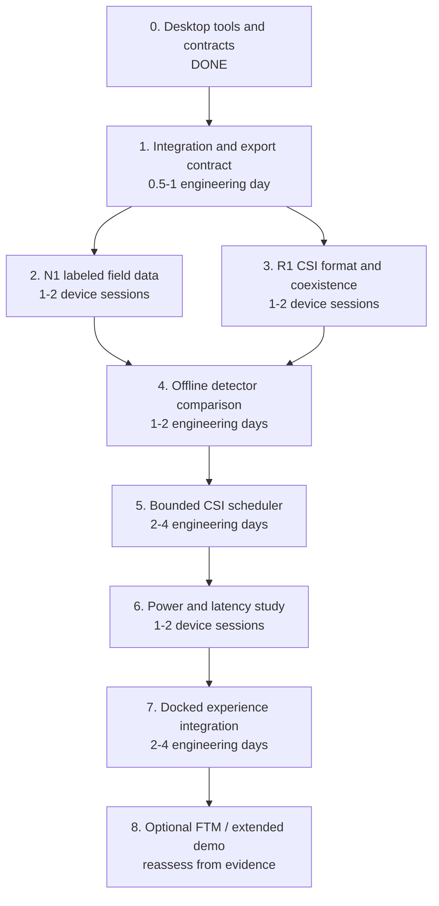

# Development Roadmap

Updated 2026-11-22. This roadmap develops docked activity awareness and lightweight walking companionship from labeled data, measured power and repeatable interaction checks.

## Target experience

- **R1: “你起来啦”** — the companion is docked with its radio endpoints fixed. It notices sustained nearby activity, wakes its eyes, and uses the existing camera to confirm who is there.
- **N1: “等等我”** — during a walk, the phone hotspot trend becomes weaker or recovers. Camera tracking supplies direction and continuity; RSSI is only supporting evidence, never a distance or bearing measurement.
- **Power behavior** — CSI is normally off. The system watches only during a bounded, useful dock window; voice and motor-control responsiveness retain priority.

## Stage map

Stages 2 and 3 share one device and are scheduled in short, separate windows. Offline analysis and planning can continue without the device.

## Stage gates

| Stage | Estimate | Goal and best path | Entry | Exit / evidence |
| --- | --- | --- | --- | --- |
| 0. Desktop tools and contracts | Complete | Portable bounded N1/R1 cores; strict validators; self-contained HTML replay | Fixed S31 source snapshot | C/Python/browser checks pass. Current simulated package is here; it is not real RF evidence. |
| 1. Integration and export contract | 0.5–1 day | Integrate through the application’s current network owner; CSI remains default off; authenticated chunked export; freeze exact firmware commit and schema | Application owner provides a completed firmware build and a device window | Existing voice, camera and control regressions pass with probe off; complete N1/CSI files export and replay. Record firmware commit, schema, enabled state and counters. |
| 2. N1 labeled phone-hotspot data | 1–2 sessions, about 30–45 min each | Keep the Android hotspot and device linked; record fixed/nearby baseline, walk-away, return, turns and pocket/body-block controls. Repeat each movement at least 5 times. Keep human labels; never convert dBm into meters. | Stage 1 export and matching device/run identity | At least 5 away and 5 toward trials, plus turn and occlusion controls. All files validate; compare held-out repetitions. Provisional target: correct trend in at least 4/5 in each direction; turns/occlusion alone do not trigger the social event. |
| 3. R1 CSI format, rate and coexistence | 1–2 sessions, about 30–45 min each | Fix both radio endpoints and the airframe/head. Capture quiet, person movement, airframe motion, channel/reconnect changes. First use received traffic; test 20 packets/s gateway ping only as a separate, bounded comparison. | Stage 1 export, stable connected AP and trustworthy motion evidence | Confirm actual byte layout, invalid prefix handling, usable packet rate and gaps. Quiet / person movement / self-motion files validate and have labels. Voice, camera and phone link have an off/on comparison. No activity claim until layout is understood. |
| 4. Offline detector comparison | 1–2 days | Compare a simple per-session baseline with an ESPectre core-only candidate after feature normalization; split evaluation by complete recording/session, not neighboring frames | Stages 2 and 3 supply valid labeled captures and format note | Publish per-trial detection, miss, false-event and delay metrics; report held-out results and limitations. Keep CSI as data only if it beats the no-CSI baseline on the intended scene. |
| 5. Bounded CSI scheduler | 2–4 days | Add a network-owner-controlled lifecycle: stop admission, stop optional traffic, disable driver CSI, settle callbacks and finalize; re-open as a new run and rebuild background. Compare an invitation-time attention window with a 6 s on / 24 s off candidate. | Detector can identify activity in real traces; current owner approves lifecycle contract | CSI is off outside selected windows; off-window status is “unknown”. Measure discovery latency and missed brief events. CSI duty fraction is reported separately from device energy. |
| 6. Power and latency study | 1–2 sessions, about 30 min per condition | Measure baseline first, then one factor at a time: CSI window, camera stream demand, dynamic CPU frequency, Wi-Fi modem sleep. Retain Wi-Fi `NONE` as baseline until voice latency is measured. | Stable build, USB/battery measurement setup and repeatable interaction script | Report Wh or mAh at a named supply point, peak current, warm-up cost, packet rate, voice start/reply latency, display quality, false/missed detections and motor-control timing. No claimed saving without measurements. |
| 7. Docked companion experience | 2–4 days | Turn a fresh activity event into a short eye/voice response, wait for vision confirmation, respect conversation and cancellation priority, then cool down | Stages 4–6 meet the selected operating targets | Repeat scripted quiet/movement/false-trigger/walk-away/cancel trials. No response from stale, self-motion, reconnect or unknown states. Demo sequence can run repeatedly without manual repair. |
| 8. Optional FTM / wider demo | Reassess | Read actual AP FTM capability first; evaluate only if N1 cannot provide useful relative continuity. Wider mobile or outdoor autonomy follows airframe power, buoyancy and tethered-motion gates. | N1/R1 evidence and a concrete use-case gap | Separate compatibility and range results. Do not use CSI as a direction/range sensor without new evidence. |

## What to record each time

1. Firmware source commit, app version, target, SDK commit, board identity and battery/USB state.
2. N1 run ID or CSI capture ID, simulated flag, Wi-Fi power-save mode, channel, AP identity, label and movement.
3. For CSI: packet rate, gaps, source/layout changes, self-motion evidence, invalid-prefix count, queued/dropped counters and the exact feature normalization.
4. For the product check: wake-to-listen, reply-start delay, camera frame freshness, false/missed events, user cancellation, voice sound and motor output state.
5. Store raw files unchanged, generate a report into a new output folder, and keep conclusions tied to those file hashes.

## Product decision rules

- Camera remains the source of person identity and left/right direction. N1 adds a coarse link trend only.
- CSI answers “did the fixed radio scene change?” It does not identify a person. Vision confirms the user.
- Short actions that occur fully inside a CSI-off interval may be missed. The invitation window and periodic sampler are compared as separate experiences.
- Conversation, photo Q&A, control, self-motion, stale sensor evidence and reconnect transitions outrank background awareness.
- Radio experiments are optional additions. The pet remains useful when the AP cannot provide repeatable CSI packets.
